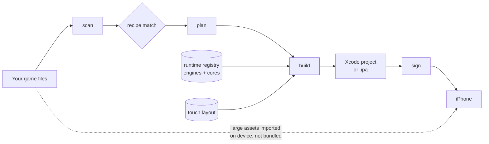

<div align="center">

# Porthole

**Bring your own game files. Walk away with an iPhone app.**

[](COPYING.md)
[](COPYING.md)
[](COPYING.md)
[](docs/ROADMAP.md)
[](docs/COMPATIBILITY.md)

</div>

---

Porthole takes a folder of game files you already own and turns it into an app that
runs on your iPhone — with touch controls, controller support, and saves that sync.

You point it at a directory. It figures out what the game is, picks a runtime that can
play it, wires up controls, and hands you something installable.

```console
$ porthole scan ~/GOG/Morrowind

Scanned ~/GOG/Morrowind  5 entries · 1.2 GB

  The Elder Scrolls III: Morrowind (2002)
  runtime   OpenMW 0.49.0   tier 1 · native port
  status    planned   confidence high
  matched   morrowind.esm, morrowind.bsa, tribunal.esm, bloodmoon.esm
  controls  rpg-virtual-cursor
  expect    60fps, high settings

  next:  porthole plan morrowind
```

That output is real — `scan` and `plan` work today. The rest of the pipeline is the
part being built:

```console
$ porthole build morrowind --mode library   # not implemented yet
$ porthole sign --free
$ porthole install
```

## Porthole never ships a single byte of anyone's game

This is the whole design constraint, and everything else follows from it.

Porthole is a **packaging pipeline**, not a game distributor. The repository contains
game *engines* (open source, redistributable), an iOS app *shell*, and *recipes* —
metadata describing how to recognize and lay out a game's files. It contains no game
assets, no ROMs, and no code to go find them for you.

You supply the game. Your GOG install, your Steam directory, your ripped cartridge,
your CD from 1998 in a shoebox. Porthole's job is format-shifting something you already
have onto hardware you already own.

We will not add asset downloading, ROM-site integration, or DRM circumvention. Those
PRs get closed. See [docs/LEGAL.md](docs/LEGAL.md) for the reasoning, which is more
interesting than "lawyers said so."

## Status

**Pre-alpha. The design is real; most of the pipeline is not yet.**

| Stage | State |
|---|---|
| `porthole scan` — identify a game from a directory | **working** |
| `porthole plan` — show runtime, controls, expectations | **working** |
| Recipe + runtime + layout schemas | **stable enough to build on** |
| `porthole build` — compile runtime, stage assets, emit Xcode project | in progress |
| iOS shell app (touch controls, importer, library) | design complete, not written |
| `porthole sign` / `install` | not started |

If you clone this today you can detect games and read a lot of documentation. You
cannot yet get a game onto a phone. [Roadmap](docs/ROADMAP.md) ·
[good first issues](../../labels/good%20first%20issue)

## How it works



Four moving parts:

- **Runtimes** — the thing that actually plays the game. A libretro emulator core, or
  ScummVM, or a from-scratch engine reimplementation like OpenMW. Cross-compiled for
  `arm64-apple-ios`. ([registry](runtimes/registry.toml))
- **Recipes** — one per game. How to detect it, which runtime, where its files go,
  which control layout, what to expect performance-wise. Plain TOML.
  ([how to write one](docs/RECIPES.md))
- **Layouts** — touch control schemes, as data. A twin-stick FPS layout, a
  point-and-click cursor, a 6-button fighting pad. Shared across games, overridable
  per game. ([schema](docs/TOUCH-CONTROLS.md))
- **Shell** — the Swift app that hosts a runtime: renders touch controls, handles MFi
  controllers, imports your game files, manages saves. ([design](docs/ARCHITECTURE.md))

### Thin app, assets on device

Game data does **not** go inside the `.ipa`. The app ships as a few megabytes of
runtime and gets its assets after installation, over AirDrop, the Files app, iCloud,
or a one-command local HTTP handoff from your desktop.

This is not a minor implementation detail — it's load-bearing:

- A free Apple developer certificate expires every **7 days**. Re-signing a 12 MB app
  takes two seconds. Re-signing a 4 GB app does not.
- App data lives outside the signed bundle, so **re-signing never wipes your saves**.
- Apple's uncompressed-bundle limits stop being your problem.
- Multi-disc PSX games, 60 GB of Morrowind mods — none of it is constrained by what
  an app bundle can hold.

### Library mode vs. standalone mode

A free Apple developer account can only hold **three app IDs at a time.** One app per
game would mean three games, forever. So:

| | `--mode library` *(default)* | `--mode standalone` |
|---|---|---|
| Apps installed | one Porthole, many games | one app per game |
| Fits free account | yes, unlimited games | 3 games max |
| Home screen | one icon, in-app library | real icon + name per game |
| Re-signing | re-sign once | re-sign each |
| Best for | most people | paid account, TrollStore, a favorite |

## The four tiers

"Any game on your iPhone" is the pitch. The honest version is "several hundred games,
in four very different ways, and not the ones from last year." Porthole labels every
recipe with the tier it lands in so expectations are set before you spend an hour.

### Tier 1 — Native port

Someone reimplemented the game's engine as open source. Your files are the assets; the
engine is native arm64 code. **This is the best outcome** — full speed, Metal
rendering, touch controls designed rather than bolted on, often *better* than the
original (higher resolution, modern aspect ratios, bug fixes).

Morrowind · Diablo · Doom · Quake 1–3 · RollerCoaster Tycoon 2 · Transport Tycoon ·
Theme Hospital · Caesar III · Heroes of Might & Magic II–III · X-COM · Arx Fatalis ·
Tomb Raider · Dark Forces · Duke Nukem 3D · Blood · Descent · Wolfenstein 3D

### Tier 2 — Emulated console

A libretro core emulates the original hardware. Your ROM or disc image runs on it.
Excellent for 8- and 16-bit; good for PSX/N64/PSP **if** the install method grants JIT
(see below).

NES · SNES · Game Boy / Color / Advance · Genesis · Master System · PlayStation ·
Nintendo 64 · PSP · Nintendo DS · Dreamcast · Arcade (MAME/FBNeo) · Atari · Amiga · C64

### Tier 3 — Interpreted runtime

The game was always data fed to an interpreter; Porthole ships the interpreter.
Reliable, low-risk, and frequently flawless.

DOS games (DOSBox) · LucasArts & Sierra adventures (ScummVM) · Godot `.pck` ·
LÖVE `.love` · Flash `.swf` (Ruffle) · Z-machine & Infocom text adventures · J2ME

### Tier 4 — Translation layer — *research track*

An arbitrary Windows x86 binary, via Wine plus x86→arm64 translation. On iOS this runs
into the JIT wall head-first and is slow even when it works.

**This is where "any game" stops being true.** It's an open research direction, not a
feature. Expect single-digit frame rates and a lot of nothing-happens. Tracked in
[#tier4](../../labels/tier-4) for people who enjoy that sort of thing.

### Not supported, and won't be

Modern AAA titles. Anything with kernel anti-cheat, online-only authentication, or
live-service dependencies. DRM-wrapped binaries — Porthole will not strip DRM, which
means if you can't already read the files, Porthole can't help. Unity and Unreal games
without engine source. Games whose publishers actively litigate decompilation
(linked, never vendored — see [LEGAL](docs/LEGAL.md#contested-upstreams)).

## Getting it onto the phone

The build is the easy half. iOS code signing is the real boss fight, and Porthole is
honest about it rather than pretending there's a magic button.

| Path | Cost | Expires | Notes |
|---|---|---|---|
| Free Apple ID + Xcode | free | **7 days** | 3 app IDs. Library mode exists for this reason. |
| Paid Apple Developer | $99/yr | 1 year | 100 devices, no weekly ritual |
| [SideStore](https://sidestore.io) | free | self-renewing | Re-signs on-device over WireGuard. The pragmatic pick. |
| [AltStore PAL](https://altstore.io) | €1.50/yr | — | EU only, fully sanctioned under the DMA |
| TrollStore | free | **never** | Permanent signing, but only on specific iOS versions |
| Jailbreak | free | — | Full JIT, full filesystem. You know if this is you. |

Full walkthrough per path: [docs/INSTALLING.md](docs/INSTALLING.md).

### The JIT wall

iOS forbids mapping memory as writable-and-executable without an entitlement Apple
doesn't hand out. Emulators for anything past the 16-bit era want a recompiler, and a
recompiler wants exactly that.

What Porthole does about it:

- Ships **interpreter fallbacks** for every Tier 2 core. Always correct, sometimes slow.
- Detects JIT availability at launch and picks the fast path when it exists — TrollStore,
  jailbreak, and the `ptrace` debugger trick on some iOS versions all unlock it.
- States the honest expectation in `porthole plan` **before** you build, per device
  generation, with and without JIT.

A note on the App Store: Apple legalized retro-console emulators in April 2024
(guideline 4.7). That permits apps *like* Delta. It does not permit an app whose
purpose is wrapping your copy of Morrowind, and GPL engines are incompatible with App
Store terms regardless. Porthole is a sideloading tool and always will be.

## Touch controls are a first-class problem

A mouse-driven 1998 strategy game does not become playable on a phone because you got
it to boot. Half the engineering here is input.

- **Layouts as data.** TOML, hot-reloadable, versioned in this repo.
- **In-app editor.** Drag buttons, resize, set opacity and deadzones, export — then
  open a PR with your layout so the next person gets it for free.
- **Real pointer emulation** for point-and-click and RTS: direct touch, trackpad-relative,
  and a virtual cursor you nudge with a stick. Right-click, drag-select, hover states.
- **Gesture bindings** — two-finger tap, edge swipe, long press — for the keyboard-heavy
  games where a 40-button overlay is absurd.
- **Controller first.** Full `GameController` support: Xbox, DualSense, Backbone,
  8BitDo. Controls auto-hide when a pad connects.
- **Haptics** on virtual buttons, which matters more than it sounds.

[Layout schema and authoring guide →](docs/TOUCH-CONTROLS.md)

## Saves that go both ways

Start a game on your desktop, finish it on the train. Where the engine's save format
is identical across platforms — and for most Tier 1 ports it is — Porthole treats your
saves as portable: iCloud sync, export to Files, and import from a desktop install.

## Quickstart

```bash
git clone https://github.com/alihammoud21/porthole
cd porthole
python3 -m porthole scan ~/path/to/your/game     # works today
python3 -m porthole plan morrowind               # works today
python3 -m porthole list games                   # works today
python3 -m porthole doctor                       # check your toolchain
```

Requires Python 3.11+. Building for a device will additionally require Xcode and a
free Apple ID — but `build` isn't finished yet, so don't go looking.

## Repository layout

```
porthole/
├── porthole/          CLI — scan, plan, build, sign, install
├── runtimes/          registry of engines & cores, per-platform build recipes
├── recipes/           one TOML per game: detection, layout, assets, notes
├── layouts/           touch control schemes
├── shell/             the iOS app (Swift) that hosts a runtime
└── docs/              architecture, legal posture, install paths, compatibility
```

## Contributing

The highest-leverage thing you can do is **write a recipe for a game you own.** It's a
30-line TOML file, needs no Swift, no C++, and no Apple developer account — and it's
how the compatibility list grows.

- [Write a recipe](docs/RECIPES.md) — start here
- [Add a touch layout](docs/TOUCH-CONTROLS.md) — needs taste more than code
- [Port a runtime to arm64-ios](docs/RUNTIMES.md) — the hard, valuable work
- [Report a game that works or doesn't](../../issues/new?template=game-report.yml)

Read [CONTRIBUTING.md](CONTRIBUTING.md) first. One rule above all others: **never
commit game assets, ROMs, or copyrighted data.** Recipes reference files by name and
hash. They never contain them.

## Licensing

Deliberately split, because linking GPL engines has consequences:

| Component | License |
|---|---|
| CLI and tooling | MIT |
| iOS shell | GPL-3.0 (it links GPL engines) |
| Recipes, layouts, docs | CC0 — facts about files shouldn't be owned |
| Bundled runtimes | **their own** — GPL-2.0, GPL-3.0, MIT, BUILD license, varies |

`porthole build` prints the license of every runtime it pulls in and writes an
attribution manifest into the app bundle. Details in [COPYING.md](COPYING.md).

## FAQ

**Is this legal?**
Emulation is settled law in the US (*Sony v. Connectix*, *Sony v. Bleem*). Open-source
engine reimplementations are clean-room work. Format-shifting media you own onto a
device you own is the least controversial act in this entire repository. What's illegal
is distributing games you don't own — which is precisely why Porthole won't touch your
game files except to copy them onto your own phone. [Longer version](docs/LEGAL.md).

**Can it run my Steam library?**
A handful of titles, yes — the ones with Tier 1 engine reimplementations that read
Steam-installed data (Sonic Mania, Tomb Raider, Dark Forces, Caesar III). Modern Steam
games, no. There's no path there that isn't Tier 4.

**Why not Android too?**
Android is strictly easier — no signing theatre, no JIT wall. iPhone is the hard
target, so the architecture gets designed against it. Android is on the roadmap once
the shell abstraction holds.

**Will this get my Apple ID banned?**
Sideloading with your own developer certificate is a supported Apple workflow. Nothing
here uses enterprise certificates, which *is* a terms violation and does get revoked.

**Does Porthole phone home about which games I have?**
No telemetry. Scanning is local. Your library is nobody's business.

---

<div align="center">
<sub>Porthole is not affiliated with Apple, or with any game publisher. Bring your own
cartridge.</sub>
</div>
